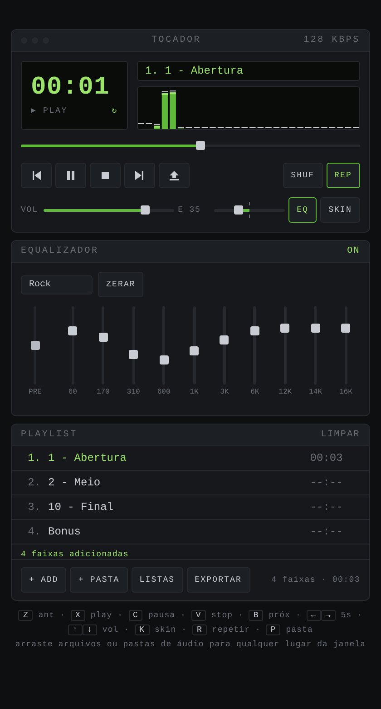

# Tocador Minimalista

**English** · [Português](README.pt-BR.md)

A minimalist, Winamp-inspired audio player that runs entirely in your browser. It is a single HTML file: nothing to install, no server, no account, no tracking — and your music never leaves your device.

> **Free for personal use.** Licensed under the [PolyForm Noncommercial License 1.0.0](LICENSE). Commercial use requires written permission — see [License](#license).

> The player's interface is in Portuguese (Brazil). This documentation is available in English and Portuguese.

## Features

| | |
|---|---|
| **Playback** | Play, pause, stop, previous/next, shuffle, repeat (off / whole playlist / current track), seek bar, volume and stereo balance (with a magnetic center: it snaps back to the middle) |
| **Winamp-style display** | Elapsed/remaining time, scrolling title, estimated bitrate |
| **Visualizer** | Spectrum bars with falling peaks, oscilloscope, or off |
| **10-band equalizer** | Preamp plus 10 presets (Flat, Rock, Pop, Jazz, Classical, Electronic, Bass+, Treble+, Vocal, Headphones) |
| **6 skins** | Classic, Amber, Ocean, Synthwave, Paper (light) and Graphite |
| **Add a whole folder** | Pick a folder (or drag it in) and every audio file inside, including subfolders, is added in natural order (2 before 10) |
| **Saved playlists** | Named playlists stored in the browser together with the audio; the last one reopens automatically |
| **Export / import** | ZIP with the audio files plus `playlist.m3u` (opens in Winamp, VLC, foobar2000…), or the M3U list alone; ZIPs can be imported back |
| **Formats** | MP3, WAV, OGG, FLAC, M4A, AAC, OPUS, WEBM (whatever your browser can decode) |
| **Privacy** | Zero third-party requests: no CDN, no web fonts, no analytics; external connections are blocked by a strict Content Security Policy |

## Quick start

**Use it online** — open the GitHub Pages site of this repository (see [Publishing](#publishing-with-github-pages)).

**Use it offline** — download [`index.html`](index.html) and open it in Chrome, Edge, Firefox or Safari.

Then tap **+ ADD** for files or **+ PASTA** for a whole folder (or drag files or folders onto the window) and press play.

### Keyboard shortcuts

| Key | Action | Key | Action |
|---|---|---|---|
| `Z` | Previous | `B` | Next |
| `X` | Play | `C` | Pause |
| `V` | Stop | `Space` | Play/Pause |
| `←` `→` | Seek ±5 s | `↑` `↓` | Volume |
| `S` | Shuffle | `R` | Repeat: off → playlist → track |
| `E` | Equalizer | `K` | Next skin |
| `L` | Open files | `P` | Add a folder |

## Documentation

- [User guide](docs/en/user-guide.md) — every feature explained, step by step, plus troubleshooting
- [Architecture](docs/en/architecture.md) — how the code works: audio graph, storage, export format, security model
- [Security policy](SECURITY.md) — protections, known risks and how to report a vulnerability
- [Contributing](CONTRIBUTING.md) — development workflow and the CSP hash tool
- [Changelog](CHANGELOG.md)

## Publishing with GitHub Pages

1. In the repository, open **Settings → Pages**
2. Under *Build and deployment*, choose **Deploy from a branch**, branch `main`, folder `/ (root)`, and save
3. After a minute or two the player is live at `https://<your-user>.github.io/<repository>/`

Note that all GitHub Pages sites of the same account share one browser origin — read [Security → Known risks](SECURITY.md#known-risks).

The `_headers` file has no effect on GitHub Pages; it adds extra HTTP security headers when the folder is deployed to Netlify or Cloudflare Pages.

## Browser support

Any current version of Chrome, Edge, Firefox or Safari (desktop and mobile). Audio formats depend on the browser's decoders — for example, FLAC and OPUS support varies on older Safari versions.

## License

Copyright © 2026 Pedro H. Borgens.

This software is **free for personal use and other noncommercial purposes** under the [PolyForm Noncommercial License 1.0.0](LICENSE). In plain words (this summary is not legal advice and does not replace the license text):

- ✅ You may use, copy, modify and share it for personal, hobby, study, research or other noncommercial purposes
- ✅ Charities, schools, public research and government institutions may use it
- ✅ When you share it, keep the license and the `Required Notice:` lines
- ❌ You may not sell it or use it in a paid product or service without written permission from the author

Want to use it commercially? Open an issue to ask for a commercial license.

This project bundles [JSZip](https://stuk.github.io/jszip/) 3.10.1 under the MIT license — see [THIRD-PARTY-NOTICES.md](THIRD-PARTY-NOTICES.md).

"Winamp" is a trademark of its respective owner. This project is an independent work inspired by it and is not affiliated with or endorsed by Winamp.
