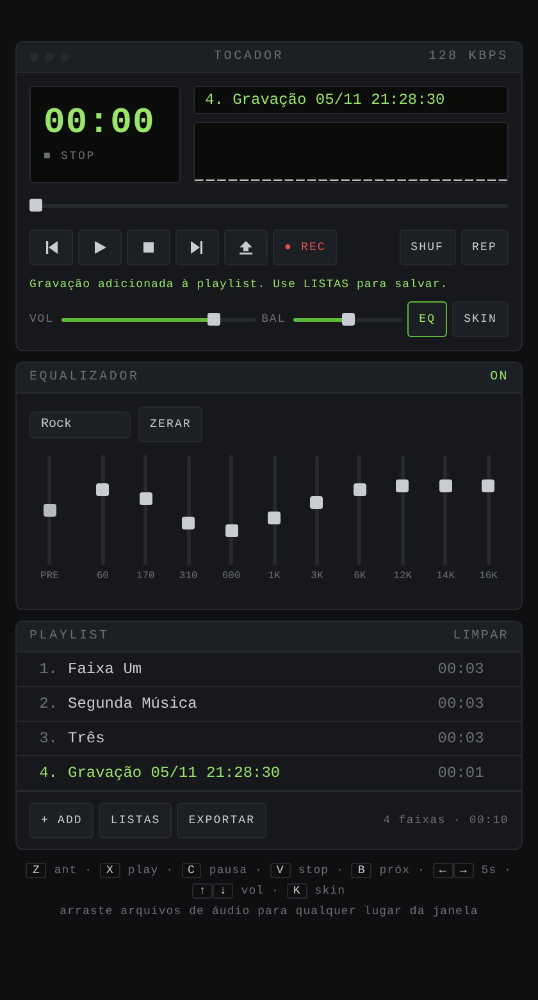

# Tocador Minimalista

[English](README.md) · **Português**

Um tocador de áudio minimalista, inspirado no Winamp, que roda inteiramente no navegador. É um único arquivo HTML: não precisa instalar nada, não tem servidor, conta nem rastreamento — e suas músicas nunca saem do seu aparelho.

> **Gratuito para uso pessoal.** Licenciado sob a [PolyForm Noncommercial License 1.0.0](LICENSE). Uso comercial exige autorização por escrito — veja [Licença](#licença).

## Recursos

| | |
|---|---|
| **Reprodução** | Tocar, pausar, parar, anterior/próxima, aleatório, repetir, barra de progresso, volume e balanço |
| **Display estilo Winamp** | Tempo decorrido/restante, título rolante, taxa de bits estimada |
| **Visualizador** | Barras de espectro com picos, osciloscópio ou desligado |
| **Equalizador de 10 bandas** | Pré-amplificador e 10 presets (Flat, Rock, Pop, Jazz, Clássica, Eletrônica, Grave+, Agudo+, Voz, Fone) |
| **6 skins** | Clássico, Âmbar, Oceano, Synthwave, Papel (claro) e Grafite |
| **Playlists salvas** | Playlists com nome guardadas no navegador junto com o áudio; a última reabre sozinha |
| **Exportar / importar** | ZIP com as músicas e um `playlist.m3u` (abre no Winamp, VLC, foobar2000…), ou só a lista M3U; o ZIP pode ser importado de volta |
| **Gravação pelo microfone** | As gravações entram direto na playlist e podem ser equalizadas, salvas e exportadas |
| **Formatos** | MP3, WAV, OGG, FLAC, M4A, AAC, OPUS, WEBM (o que o seu navegador souber decodificar) |
| **Privacidade** | Zero requisições a terceiros: sem CDN, sem fontes da web, sem estatísticas; conexões externas bloqueadas por uma política de segurança (CSP) rígida |

## Começando

**Online** — abra o site do GitHub Pages deste repositório (veja [Publicação](#publicação-com-github-pages)).

**Offline** — baixe o [`index.html`](index.html) e abra no Chrome, Edge, Firefox ou Safari.

Depois toque em **+ ADD** (ou arraste arquivos de áudio para a janela) e aperte play.

### Atalhos de teclado

| Tecla | Ação | Tecla | Ação |
|---|---|---|---|
| `Z` | Anterior | `B` | Próxima |
| `X` | Tocar | `C` | Pausar |
| `V` | Parar | `Espaço` | Tocar/Pausar |
| `←` `→` | Avançar/voltar 5 s | `↑` `↓` | Volume |
| `S` | Aleatório | `R` | Repetir |
| `E` | Equalizador | `K` | Próxima skin |
| `L` | Abrir arquivos | | |

A gravação só começa com um clique em **● REC** — de propósito, não há atalho de teclado.

## Documentação

- [Guia de uso](docs/pt-BR/guia-de-uso.md) — todos os recursos explicados passo a passo, mais solução de problemas
- [Arquitetura](docs/pt-BR/arquitetura.md) — como o código funciona: cadeia de áudio, armazenamento, formato de exportação, modelo de segurança
- [Política de segurança](SECURITY.md#português) — proteções, riscos conhecidos e como reportar uma vulnerabilidade
- [Como contribuir](CONTRIBUTING.md#português) — fluxo de desenvolvimento e a ferramenta de hash da CSP
- [Histórico de mudanças](CHANGELOG.md)

## Publicação com GitHub Pages

1. No repositório, abra **Settings → Pages**
2. Em *Build and deployment*, escolha **Deploy from a branch**, branch `main`, pasta `/ (root)`, e salve
3. Em um ou dois minutos o tocador estará em `https://<seu-usuario>.github.io/<repositorio>/`

A gravação pelo microfone exige HTTPS, que o GitHub Pages oferece. Atenção: todos os sites do GitHub Pages de uma mesma conta compartilham a mesma origem no navegador — leia [Segurança → Riscos conhecidos](SECURITY.md#riscos-conhecidos) antes de guardar gravações privadas ali.

O arquivo `_headers` não tem efeito no GitHub Pages; ele adiciona cabeçalhos HTTP de segurança extras quando a pasta é publicada no Netlify ou no Cloudflare Pages.

## Navegadores compatíveis

Versões atuais do Chrome, Edge, Firefox ou Safari (computador e celular). A gravação usa `MediaRecorder` (Safari 14.1 ou mais novo). Os formatos de áudio dependem dos decodificadores do navegador — por exemplo, o suporte a FLAC e OPUS varia em versões antigas do Safari.

## Licença

Copyright © 2026 Pedro H. Borgens.

Este software é **gratuito para uso pessoal e outros fins não comerciais**, nos termos da [PolyForm Noncommercial License 1.0.0](LICENSE). Em palavras simples (este resumo não é aconselhamento jurídico e não substitui o texto da licença, que é o que vale):

- ✅ Você pode usar, copiar, modificar e compartilhar para uso pessoal, hobby, estudo, pesquisa ou outros fins não comerciais
- ✅ ONGs, escolas, instituições de pesquisa pública e órgãos de governo podem usar
- ✅ Ao compartilhar, mantenha a licença e as linhas `Required Notice:`
- ❌ Não é permitido vender nem usar em produto ou serviço pago sem autorização por escrito do autor

Quer usar comercialmente? Abra uma issue pedindo uma licença comercial.

Este projeto inclui o [JSZip](https://stuk.github.io/jszip/) 3.10.1 sob a licença MIT — veja [THIRD-PARTY-NOTICES.md](THIRD-PARTY-NOTICES.md).

"Winamp" é marca registrada de seu respectivo dono. Este projeto é um trabalho independente inspirado nele, sem afiliação ou endosso do Winamp.
